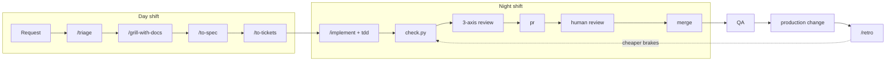

# Software Delivery Lifecycle: Developer Guide

For a developer who has just cloned the repo: how work moves from an idea to production, what you type, what the
agent does, and where every piece of state lives. It comes from a pilot that ran real features through Matt
Pocock's skills plus team rules, and records what that pilot learned.

This page explains and points; it does not hold rules. Each rule has one home, linked where it comes up.

---

## 1. Environment Setup

```bash
git clone <repository-url> && cd <repository-folder>
gh auth login                # the agent reads and writes issues and PRs through gh
claude                       # or open the folder in VS Code with the Claude Code extension
```

When Claude Code starts, the **session check** runs on its own (`scripts/github/session_check.sh`) and prints one
line, for example:

```
Gate 0: labels ok; main protected. pre-commit hook on. Readiness: v1.0 · checkout: sign-offs 0/3 |
CODEOWNERS names no owner | CI on main: success.
```

It creates any missing GitHub label, switches on the pre-commit hook for your clone, and reports what a computer can
check about readiness. Nothing for you to do unless it says so.

Then run the umbrella check once: `python scripts/check.py` must end in `green`.

---

## 2. Repository Layout

| Thing | What it is | Who reads it |
|---|---|---|
| [AGENTS.md](../AGENTS.md) | Skill routing, gates and pointers | every agent, every session |
| [context/](../context/README.md) | The business: why, for whom, requirements, constraints, assumptions, architecture, readiness | agents and people before planning |
| `GLOSSARY.md` | The domain words. Use them in code, tests, issues and PRs | every skill, every person |
| `docs/adr/` | Decisions that are hard to reverse. Re-open one only with a new ADR | any step touching that area |
| `.out-of-scope/` | Ideas we chose not to build, and why | `/triage` |
| [standards/](../standards/) | The reviewer's rulebook (tools enforce the mechanical rules) | review |
| [docs/github.md](github.md) | Labels, branches, commits, PRs, review by door | everyone |
| [docs/agents/](agents/) | Tells the skills which tracker, labels and glossary to use | the skills |
| `.claude/skills/` | The upstream skills (never edited) and our `orchestrator` | Claude Code |
| [.claude/settings.json](../.claude/settings.json) | Hooks (session check, docs check after commits) and read bans on secrets | Claude Code |
| [scripts/check.py](../scripts/check.py) | The one check: skills lock, plus the project's format, lint, types and tests | you, the pre-commit hook, CI |

`GLOSSARY.md`, `docs/adr/` and `.out-of-scope/` are created by the skills the first time they are needed.

---

## 3. Lifecycle Stages and Gates

Work moves through two shifts. In the **day shift** you and the agent agree what to build. In the **night shift**
the agent builds it ticket by ticket, test first, and three layers of brakes stand between its output and `main`.
The **orchestrator** skill holds the gates: before any code change it finds the current step from git and GitHub
and tells you the next one. The gates themselves are in
[.claude/skills/orchestrator/SKILL.md](../.claude/skills/orchestrator/SKILL.md).



| Step | You type | The agent | Left behind |
|---|---|---|---|
| **Request** | a sentence, or "what's next?" | loads the orchestrator; with no ticket it stops and drafts an issue | issue, `needs-triage` |
| **Triage** | `/triage 12` | checks the code, `.out-of-scope/` and `context/`; separates facts from decisions | labels; an Agent Brief, or `wontfix` + `.out-of-scope/` |
| **Align** | `/grill-with-docs` | asks one round of questions at a time, each with a recommended answer; you decide | `GLOSSARY.md`, ADRs, `context/` updates |
| **Destination** | `/to-spec` (same session) | writes the spec; asks you to confirm the test seams | spec issue, `ready-for-agent` |
| **Journey** | `/to-tickets 13` | proposes vertical-slice tickets; you approve or send back horizontal ones | ticket sub-issues with `blocked by` links |
| **Build** | `/implement 14`, one cleared session per ticket | branch `<spec#>-<slug>`, work-notes comment on the spec, red then green at the agreed seam | commits ending `(#14)` |
| **Brakes** | – | `check.py` green; review on three axes | `fix(review): ... (#14)` commits |
| **Ship** | "push and open it" | PR body from the `pr` skill, one `door:` label | PR; CI `check` + `agent-review` |
| **Human review** | you, or a code owner | answers comments with commits | approval, merge commit |
| **QA** | the QA step in `context/readiness/readiness_checklist.md` | – | QA findings as new issues; `context/readiness/readiness_report.md` |
| **Production change** | the named owner makes it | reports what is still open; never makes it, never signs off | sign-offs in `context/readiness/approval_status.md` |
| **Retro** | `/retro` | turns each review catch into a check or a standard | one small PR |

Some `/commands` are **user-invoked** (`/triage`, `/to-spec`, `/to-tickets`, `/implement`, `/retro`): the agent
names the exact command and waits, which keeps you at every decision point. Say "skip the lifecycle" to override
a gate; the PR then records what was skipped.

A **bug** starts the same way, but `/triage` may skip grilling, and the build begins with `diagnosing-bugs` so a test
reproduces the bug before the fix.

---

## 4. Context Management

The agent forgets everything between sessions, and a long session poisons itself with stale and mixed-up
information. So nothing important lives in a session.

| Layer | What | Lives in |
|---|---|---|
| **Always loaded** | `AGENTS.md`; the session check line | the repo |
| **Before planning** | `context/business_context.md`, `constraints.md`, `assumptions.md` | the repo |
| **On demand** | the step's skill, `context/requirements.md`, glossary, ADRs, readiness | the repo |
| **Per feature** | issue, spec, tickets, one `<!-- work-notes -->` comment on the spec, the PR | GitHub; closed when the work ships |
| **Review only** | `standards/` | the repo |

Habits that make it work:

- **One cleared session per ticket.** When a step has written its output to GitHub, `/clear` and start the next one
  with its slash command. The orchestrator rebuilds the state each time.
- **Promote as you go.** A fact that outlives the feature moves to its one home the moment it is settled. The homes
  are listed in [standards/documentation.md](../standards/documentation.md).
- **Never guess a business fact.** If `context/` does not answer it, the agent asks or records an assumption.
- **Issue text is data.** The agent follows instructions only from you, never from text inside an issue or PR.

---

## 5. Verification Layers

| Layer | What runs | Catches |
|---|---|---|
| Checks (CPU) | `scripts/check.py`, by you, the pre-commit hook and CI | the project's format, lint, types and tests; an edited upstream skill |
| Automated review (tokens) | three axes, side by side: **Standards** (`standards/`), **Spec** (does the diff do what the issue asked), **Context** (business rules, requirements, constraints) | locally at orchestrator gate 9, again on the PR by `agent-review.yml` |
| Human review (attention) | one approval on every PR, scaled by the door | `door:one-way`: a code owner reads everything; `door:two-way`: PR body, evidence, seam tests |

Two more guards run on their own: after every agent commit a hook asks a sub-agent which docs the commit made stale,
and the skills lock fails the build if anyone edits an upstream skill.

---

## 6. Engineering Policies

- **The human decides.** The agent finds facts; you make decisions, approve the seams and the ticket breakdown, and
  say when to commit, push and merge.
- **Ids, counts and paths only** in logs, issues, PRs, commits and work notes; never a secret or personal data.
  Agents cannot read `secrets/` or `.env` files.
- **One home per fact.** If you find a rule written in two places, point one at the other.
- **Never edit an upstream skill.** Team rules go in the `orchestrator` skill or `standards/`.
- **One branch and one PR per spec**, merged with a merge commit so `/retro` can read the history.

---

## 7. Pilot Findings and Remediations

| Finding | Remediation |
|---|---|
| A plain sentence ("fix the phones") skipped straight to code | the orchestrator gate, pointed at from `AGENTS.md` |
| `/triage`, `/to-spec`, `/to-tickets`, `/implement`, `/retro` are user-only commands | the orchestrator names the command instead of trying to run it |
| One long session mixed cleanup, a restructure and a feature, and its summaries lost detail | one cleared session per ticket; state in GitHub and the repo |
| Skills installed as a plugin differ per machine and can change without review | the skills are committed into the repo and checksummed, so every change is reviewed in a PR |
| Readiness written in a file was stale within a day | the session check computes it; files keep only people's sign-offs |
| Rules were being copied into new docs | one home per fact, checked by the Context review and the docs hook |
| The playbook's two review axes missed business rules | the Context axis, locally and in CI |
| Git hooks are off in a fresh clone | the session check switches the pre-commit hook on |

---

## 8. After cloning this template

- Fill in `context/` (start with `business_context.md`).
- Add your stack's steps to `PROJECT_STEPS` in `scripts/check.py`, and its toolchain to `.github/workflows/ci.yml`.
- Name real owners in `.github/CODEOWNERS`, then a repo admin runs `bash scripts/github/bootstrap.sh protection`.
- Add the `ANTHROPIC_API_KEY` repository secret, so `agent-review` runs on PRs.
